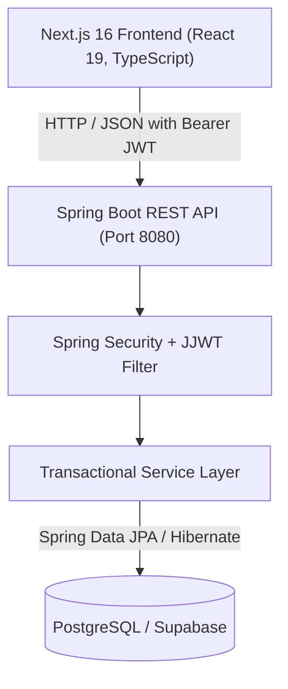

# 🎓 Student Management System (CampusFlow)

A modern, full-stack academic management and student administration platform. Built with **Spring Boot 4 (Java 21)** and **Next.js 16 (React 19 / TypeScript)**, featuring secure role-based portals for students and administrators, academic course registration, self-service profile modification requests, and an administrative approval workflow.

---

## 📌 Table of Contents

- [Overview](#-overview)
- [System Architecture](#-system-architecture)
- [Key Features](#-key-features)
- [Tech Stack](#-tech-stack)
- [Project Structure](#-project-structure)
- [REST API Reference](#-rest-api-reference)
- [Prerequisites](#-prerequisites)
- [Configuration & Environment Variables](#-configuration--environment-variables)
- [Local Setup & Getting Started](#-local-setup--getting-started)
  - [1. Backend Setup (Spring Boot)](#1-backend-setup-spring-boot)
  - [2. Frontend Setup (Next.js)](#2-frontend-setup-nextjs)
- [Running Tests](#-running-tests)
- [Security & Access Control](#-security--access-control)
- [License](#-license)

---

## 📖 Overview

The **Student Management System** bridges communication between academic registrars and students. Beyond standard student directory and course catalog CRUD operations, it provides an auditable **Change Request & Adjudication Pipeline**:

1. Students submit change petitions for key profile fields (e.g., legal name correction, contact email update, or degree course transfer) along with formal justification reasons.
2. Administrators review petitions on their adjudication dashboard, inspect changes and reasons, and approve or reject them with feedback comments.
3. Approved requests automatically update student records and linked authentication credentials transactionally in the PostgreSQL database.
4. Students receive real-time status notifications on their portal.

---

## 🏗 System Architecture



---

## ✨ Key Features

### 👨‍🎓 Student Portal
- **Self-Registration & Enrollment**: New students sign up with validated email, password confirmation, and program course selection.
- **Student Dashboard**: Live overview of enrolled course details, attendance rate indicators, academic term progress, active requests counter, and unread alerts.
- **Profile Viewer**: Displays academic credentials, student ID, and registered contact information.
- **Change Request Submission**: Submit structured update requests for name, email address, or course transfer with required justification reasons.
- **Notification Center**: Track change petition outcomes (`PENDING`, `APPROVED`, `REJECTED`) with administrator remarks and mark-as-read filtering.

### 🛡️ Administrator Portal
- **Registrar Dashboard**: High-level operational metrics (total students, active courses, pending approval queue).
- **Student Directory Management**: Full CRUD operations on student records, course reassignments, and email updates.
- **Course Catalog Management**: Add new academic programs, edit syllabus descriptions, and remove obsolete courses.
- **Change Request Adjudication**: Filter requests by status, review student justifications, enter administrator comments, and approve or reject petitions in one click.

### 🔐 Security & Reliability
- **Stateless JWT Authentication**: Secure token generation and verification using `io.jsonwebtoken` (JJWT 0.13.0).
- **Password Protection**: BCrypt hashing applied to all stored credentials.
- **Role-Based Access Control (RBAC)**: Strict segregation between `ROLE_STUDENT` and `ROLE_ADMIN` routes.
- **Global Error Handling**: Consistent, RFC-compliant JSON error bodies via `@RestControllerAdvice` for validation errors, constraints, and HTTP exceptions.

---

## 💻 Tech Stack

| Domain | Technology | Description |
| :--- | :--- | :--- |
| **Backend Framework** | Spring Boot 4.1.1 | Enterprise Java framework for REST APIs and services |
| **Language** | Java 21 | Modern LTS Java runtime |
| **Security** | Spring Security & JJWT | Stateless JWT authentication & authorization filter chain |
| **ORM / Data** | Spring Data JPA / Hibernate | Object-Relational Mapping with Hikari connection pooling |
| **Database** | PostgreSQL (Supabase) | Cloud-hosted relational database |
| **Frontend Framework**| Next.js 16 (App Router) | React server/client component framework |
| **UI Library** | React 19 & TypeScript 5 | Component-driven UI with static type safety |
| **Styling** | Vanilla CSS & CSS Modules | Responsive, custom-tailored design system |
| **Build Tools** | Maven Wrapper & npm | Standard dependency management and build pipelines |

---

## 📂 Project Structure

```text
student-management-system/
├── backend/                               # Spring Boot application
│   ├── .mvn/wrapper/                      # Maven wrapper files
│   ├── src/
│   │   ├── main/
│   │   │   ├── java/com/gamage/backend/
│   │   │   │   ├── config/                # PasswordEncoder & app configurations
│   │   │   │   ├── controller/            # REST controllers (Auth, Student, Course, Requests)
│   │   │   │   ├── dto/
│   │   │   │   │   ├── request/           # Incoming request DTOs with validation annotations
│   │   │   │   │   └── response/          # Structured JSON response records
│   │   │   │   ├── entity/                # JPA entities (AppUser, Student, Course, ChangeRequest)
│   │   │   │   ├── exception/             # GlobalExceptionHandler (@RestControllerAdvice)
│   │   │   │   ├── repository/            # Spring Data JPA repositories
│   │   │   │   ├── security/              # SecurityConfig, JwtService, JwtAuthenticationFilter
│   │   │   │   └── service/               # Business logic & transactional operations
│   │   │   └── resources/
│   │   │       ├── application.properties # Spring Boot configuration
│   │   │       └── static/
│   │   └── test/java/com/gamage/backend/  # Unit and integration test suites
│   ├── pom.xml                            # Maven dependencies & plugins
│   ├── mvnw                               # Linux/macOS Maven wrapper script
│   └── mvnw.cmd                           # Windows Maven wrapper script
│
├── frontend/                              # Next.js frontend application
│   ├── src/
│   │   ├── app/
│   │   │   ├── admin/                     # Administrator pages
│   │   │   │   ├── courses/               # Course catalog management
│   │   │   │   ├── dashboard/             # Admin registrar overview
│   │   │   │   ├── login/                 # Admin authentication
│   │   │   │   ├── requests/              # Request review & approval queue
│   │   │   │   └── students/              # Student roster & CRUD
│   │   │   ├── components/                # Shared UI components (Navbar, icons)
│   │   │   ├── student/                   # Student portal pages
│   │   │   │   ├── dashboard/             # Student home & metrics
│   │   │   │   ├── login/                 # Student authentication
│   │   │   │   ├── notifications/         # Notification & alert center
│   │   │   │   ├── profile/               # Profile details & enrollment status
│   │   │   │   ├── register/              # New student onboarding
│   │   │   │   └── requests/              # Submit & view change requests
│   │   │   ├── globals.css                # Global design system & theme variables
│   │   │   ├── layout.tsx                 # Root layout with persistent navigation
│   │   │   └── page.tsx                   # Default entrypoint
│   │   └── lib/
│   │       ├── api.ts                     # Fetch wrapper with auto JWT attachment
│   │       └── auth.ts                    # Client-side session and token helpers
│   ├── package.json                       # Next.js / React dependencies
│   └── tsconfig.json                      # TypeScript configuration
│
├── .env                                   # Root environment variables
└── README.md                              # Project documentation
```

---

## 📡 REST API Reference

### 1. Authentication (`/api/auth`)
| Method | Endpoint | Access | Description |
| :--- | :--- | :--- | :--- |
| `POST` | `/api/auth/register` | Public | Register a student account & profile |
| `POST` | `/api/auth/login` | Public | Authenticate student or admin; returns JWT token |

### 2. Courses (`/api/courses`)
| Method | Endpoint | Access | Description |
| :--- | :--- | :--- | :--- |
| `GET` | `/api/courses` | Public | Fetch all available academic courses |
| `GET` | `/api/courses/{id}` | Public | Get single course by ID |
| `POST` | `/api/courses` | `ROLE_ADMIN` | Create a new academic course |
| `PUT` | `/api/courses/{id}` | `ROLE_ADMIN` | Update an existing course |
| `DELETE`| `/api/courses/{id}` | `ROLE_ADMIN` | Remove a course |

### 3. Students Management (`/api/students`)
| Method | Endpoint | Access | Description |
| :--- | :--- | :--- | :--- |
| `GET` | `/api/students` | `ROLE_ADMIN` | Retrieve all student records |
| `GET` | `/api/students/{id}` | `ROLE_ADMIN` | Retrieve single student profile |
| `POST` | `/api/students` | `ROLE_ADMIN` | Manually register a new student |
| `PUT` | `/api/students/{id}` | `ROLE_ADMIN` | Update student details and assigned course |
| `DELETE`| `/api/students/{id}` | `ROLE_ADMIN` | Remove student record |

### 4. Student Self-Service (`/api/student`)
| Method | Endpoint | Access | Description |
| :--- | :--- | :--- | :--- |
| `GET` | `/api/student/me` | `ROLE_STUDENT` | Get authenticated student's profile & course |
| `POST` | `/api/student/requests` | `ROLE_STUDENT` | Submit a profile change petition (`name`, `email`, `course`) |
| `GET` | `/api/student/requests` | `ROLE_STUDENT` | Retrieve current student's change request history |

### 5. Administrative Approvals (`/api/admin`)
| Method | Endpoint | Access | Description |
| :--- | :--- | :--- | :--- |
| `GET` | `/api/admin/requests` | `ROLE_ADMIN` | Retrieve all student change petitions (optional `?status=`) |
| `PUT` | `/api/admin/requests/{id}/review` | `ROLE_ADMIN` | Approve or reject a request with administrative feedback |

---

## ⚙️ Prerequisites

Ensure the following tools are installed on your machine before running the project:

- **Java Development Kit (JDK)**: Version 21 or higher
- **Node.js**: Version 18.18.0 or higher (Node 20+ LTS recommended)
- **npm**: Version 9 or higher
- **PostgreSQL Database**: Either a local instance or a cloud database (e.g., [Supabase](https://supabase.com/))
- **Git**

---

## 🔑 Configuration & Environment Variables

### Root / Backend `.env`
Create a `.env` file in the project root or configure these variables in `backend/src/main/resources/application.properties`:

```properties
# PostgreSQL Database Connection
DB_URL=jdbc:postgresql://<HOST>:<PORT>/<DATABASE>?sslmode=require
DB_USERNAME=<DATABASE_USERNAME>
DB_PASSWORD=<DATABASE_PASSWORD>

# JWT Secret Key (Base64-encoded, minimum 256 bits)
JWT_SECRET=<YOUR_BASE64_SECRET_KEY>
```

### Frontend Environment (`frontend/.env.local` optional)
By default, the frontend connects to `http://localhost:8080`. To override:

```env
NEXT_PUBLIC_API_URL=http://localhost:8080
```

---

## 🚀 Local Setup & Getting Started

### 1. Clone Repository
```bash
git clone https://github.com/your-username/student-management-system.git
cd student-management-system
```

### 2. Backend Setup (Spring Boot)

1. Open a terminal and navigate to the backend directory:
   ```bash
   cd backend
   ```

2. Verify that your database connection in `application.properties` or root `.env` is accessible.

3. Run the Spring Boot application using the Maven wrapper:
   - **Windows (Command Prompt / PowerShell)**:
     ```powershell
     .\mvnw.cmd spring-boot:run
     ```
   - **Linux / macOS**:
     ```bash
     ./mvnw spring-boot:run
     ```

4. The backend server starts on:
   ```text
   http://localhost:8080
   ```

### 3. Frontend Setup (Next.js)

1. Open a new terminal and navigate to the frontend directory:
   ```bash
   cd frontend
   ```

2. Install dependencies:
   ```bash
   npm install
   ```

3. Launch the Next.js development server:
   ```bash
   npm run dev
   ```

4. Open your browser and navigate to:
   ```text
   http://localhost:3000
   ```

---

## 🧪 Running Tests

### Backend Unit & Integration Tests
Execute the JUnit 5 test suite using Maven:

```bash
cd backend
./mvnw test        # Linux / macOS
.\mvnw.cmd test    # Windows
```

Tests cover:
- `CourseServiceTest`: Course creation, updates, duplicate name checks, and deletion constraints.
- `StudentServiceTest`: Student registration, email conflict checks, and course linking.
- `BackendApplicationTests`: Spring application context loading.

### Frontend Linting & Type Checking
```bash
cd frontend
npm run lint
```

---

## 🛡️ Security & Access Control

- **Stateless Authorization**: All authenticated endpoints require an `Authorization: Bearer <TOKEN>` header.
- **CORS Support**: Pre-configured to support local development (`http://localhost:3000`) with support for `GET`, `POST`, `PUT`, `DELETE`, and `OPTIONS` preflight requests.
- **Cascading Integrity**: Upon approval of student change petitions, transactions apply changes atomically to both the `Student` profile and the linked `AppUser` account credentials to prevent state mismatch.

---

## 📄 License

This project is licensed under the [MIT License](LICENSE).
